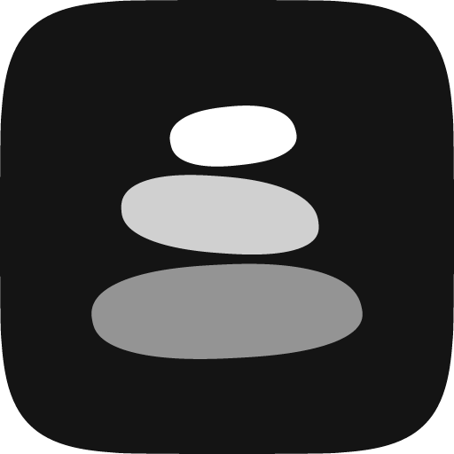
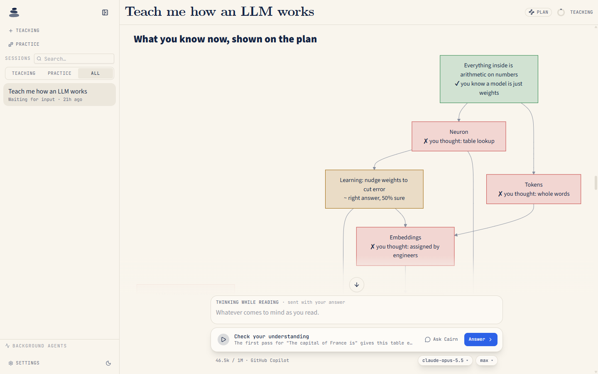
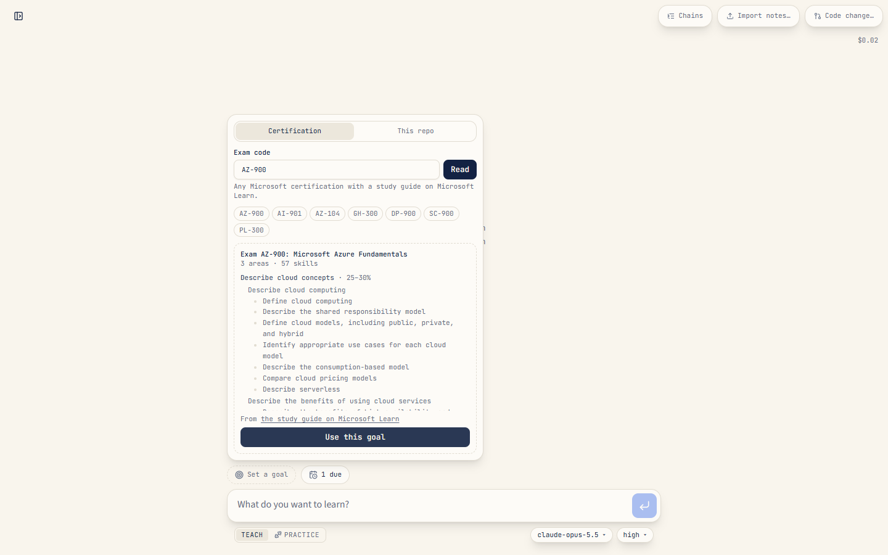
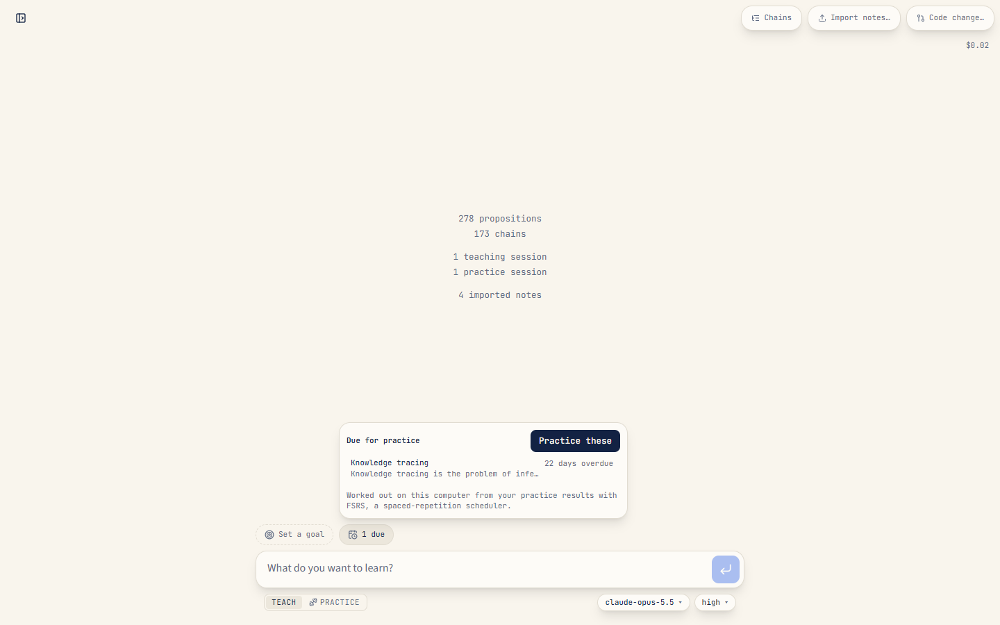
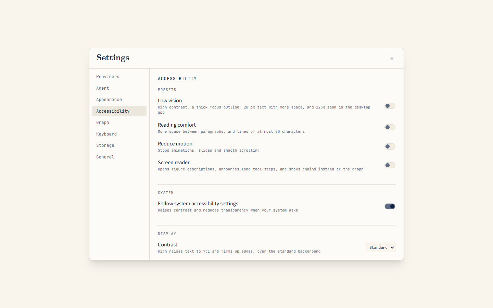
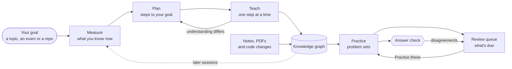
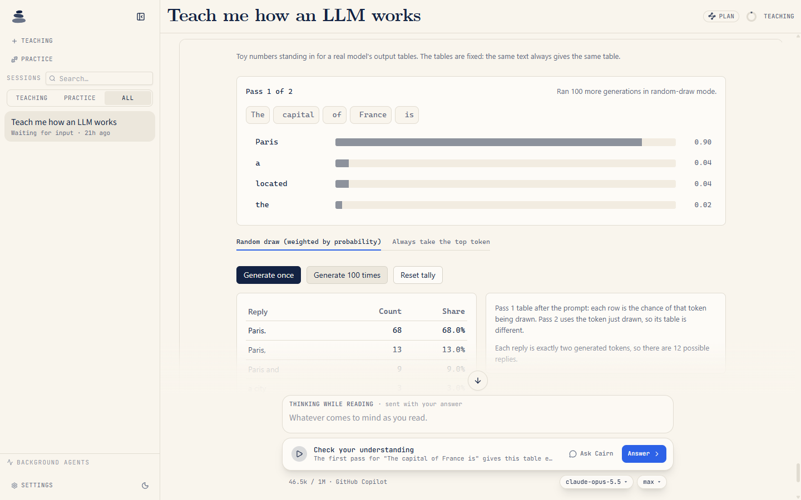
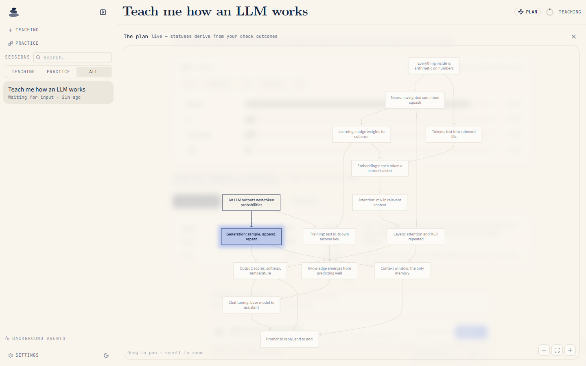

<p align="center">
  
</p>

<h1 align="center">Cairn</h1>

<p align="center">
  <strong>An AI tutor that runs on your GitHub Copilot subscription.</strong>
</p>

<p align="center">
  <a href="https://github.com/Bakar404/cairn/releases/latest"></a>
  <a href="https://github.com/Bakar404/cairn/actions/workflows/ci.yml"></a>
  <a href="LICENSE"></a>
</p>

<p align="center">
  <a href="#what-makes-cairn-different">What's different</a> ·
  <a href="#why-you-can-trust-it">Why you can trust it</a> ·
  <a href="#download">Download</a> ·
  <a href="#getting-started">Getting started</a> ·
  <a href="#your-data">Your data</a> ·
  <a href="docs/README.md">Documentation</a>
</p>

Cairn finds out what you already understand, plans a path to your goal and teaches one reasoning step at a time. Like stones in a cairn, each new idea rests on one you already have, and a persistent knowledge graph carries the path from one session to the next.

Aim a lesson at a Microsoft certification or at your own code, learn from a pull request, and come back when an idea is due for review. Every model call runs on your GitHub Copilot plan with no API keys, and a second model double-checks each practice verdict.

<picture>
  <source media="(prefers-color-scheme: dark)" srcset="docs/images/lesson-dark.png">
  
</picture>

<p align="center"><sub>After a few opening questions, Cairn shows on the plan what you already know and which ideas to fix first.</sub></p>

> [!IMPORTANT]
> **Early release.** Every model call and web search runs on your GitHub Copilot subscription. The desktop installers are new: they pass automated checks on macOS, Windows and Linux but haven't yet had a full hands-on pass on each system. They aren't signed by a trusted publisher either, so Windows and macOS warn you the first time you open Cairn, and [Download](#download) explains what to do. Azure voice is still planned, so there's no built-in dictation.

## What makes Cairn different

> [!NOTE]
> Everything in this section except [Runs on your GitHub Copilot](#runs-on-your-github-copilot) is new in Cairn 0.5.0. The [changelog](CHANGELOG.md) lists every change.

Cairn began as a fork of LearnHarness, which gave it the teaching loop and the knowledge graph (see [Built on LearnHarness](#built-on-learnharness)). This is what Cairn builds around them.

### Learn toward a real goal

**Set a goal**, beside the lesson box, aims a new lesson at something concrete:

- **A Microsoft certification.** Enter an exam code, such as AZ-104 or GH-300. Cairn reads the exam's study guide on Microsoft Learn and weights each skill area by its share of the exam. It measures and plans every area, and when one needs no teaching, it says so rather than dropping it. It teaches the material itself: no exam tricks, question dumps, mock exams or timed tests. This uses Microsoft Learn, which is on by default.
- **A code repository.** Enter the path of a folder on your computer and choose **Scan**. Cairn reads the folder's dependency manifests and file names and lists the technologies it uses. Only the ones you keep go to the tutor, which teaches them from the repository's own code and tells you when it hasn't read the code a point rests on.

<picture>
  <source media="(prefers-color-scheme: dark)" srcset="docs/images/goal-dark.png">
  
</picture>

<p align="center"><sub>Set a goal reads an exam's study guide on Microsoft Learn and weights each skill area by its share of the exam.</sub></p>

### Learn from a code change

**Code change…**, next to **Import notes…** on the home screen, brings a GitHub pull request or a range of local commits into your knowledge graph:

- Cairn reads the reasons first (the title, the description and the commit messages), then the diff.
- Practice on a change asks *why* the code changed, with the diff in the problem.
- Public pull requests work as they are. For a private one, sign in with the GitHub CLI (`gh auth login`).
- For local commits, give a range such as `HEAD~3..HEAD`, a branch comparison such as `main...my-branch`, or one commit. Leave it empty for the latest commit.
- Lock files, build output, vendored code, minified bundles, source maps, test snapshots and binary files are left out.

### Remember what you learn

The review pill on the home screen counts the ideas due for practice, such as **3 due**. Cairn schedules them from your practice sessions with [FSRS](https://github.com/open-spaced-repetition/ts-fsrs), a spaced-repetition scheduler: an idea you solved unaided comes back later, and one you needed hints for or missed comes back sooner.

- **Practice these** starts a practice session on the ten most overdue ideas.
- An idea missed three times moves to **Keeps slipping**, where **Teach again** starts a fresh lesson on it instead of more drilling.
- Nothing new is stored. The queue is worked out on your computer from your sessions each time.

<picture>
  <source media="(prefers-color-scheme: dark)" srcset="docs/images/review-dark.png">
  
</picture>

<p align="center"><sub>The review pill opens what's due, worked out on your computer from your practice results.</sub></p>

### Grounded in official sources

- **Microsoft Learn (on by default).** Research can search and read Microsoft's official documentation and code samples through the [Microsoft Learn MCP Server](https://learn.microsoft.com/training/support/mcp), alongside Copilot's web search. Cairn sends Learn only search words and page addresses, never your lesson. Switch it in **Settings → Agent → Microsoft Learn**.
- **PDF import.** **Import notes…** now takes PDFs as well as Markdown and text, page by page. Cairn reads a PDF's text layer and doesn't run OCR.
- **Checked quotes.** An idea taken from a document or code change you imported can keep the short passage it came from, checked word for word against the source, with its PDF page or the diff around it. A quote the source doesn't contain is dropped. The idea's card shows these passages, and the tutor cites them.

### Accessible by design

**Settings → Accessibility** brings the options together. Presets for **Low vision**, **Reading comfort**, **Reduce motion** and **Screen reader** set several at once, and each value they set stays editable on its own.

- **High contrast** raises text to 7:1 against its background (WCAG AAA), and borders, field edges and chart colors to 4.5:1, in light and dark mode. The knowledge graph and diagrams repaint to match, as do figures and demos drawn in Cairn's palette.
- **Follows your system.** When your system asks for more contrast or less transparency, Cairn follows, and Windows contrast themes are always honored. **Motion** follows your system too, or set it to Reduced or Full.
- **Reading comfort** sliders set the lesson text's line height, paragraph spacing, letter spacing, word spacing and reading width.
- **Keyboard.** Every control can be reached with Tab and Shift+Tab, keyboard focus always shows an outline, and F6 moves between text fields. See [Keyboard shortcuts](docs/keyboard.md).
- **Screen readers** hear when a reply starts and when it finishes, and an answered quiz states each verdict in words. New figures get alt text and a Describe section, and new animations get a transcript and a WebVTT descriptions track.
- **Checked in CI.** axe-core's WCAG 2.0–2.2 A and AA rules run against the production build with normal, forced-colors and reduced-motion settings, and violations are counted against a baseline that can only go down. See [Accessibility checks](docs/development.md#accessibility-checks) and the [design notes](docs/design.md#accessibility).

<picture>
  <source media="(prefers-color-scheme: dark)" srcset="docs/images/accessibility-dark.png">
  
</picture>

### Runs on your GitHub Copilot

- Every model call and web search runs on your Copilot plan through the official [GitHub Copilot SDK](https://github.com/github/copilot-sdk). There are no model keys, and Cairn runs no servers of its own and includes no analytics.
- Three model slots: **Strong**, the main model for your sessions; **Cheap**, for the assistants that research, build demos and grade your work; and **Vision**, for the assistants that draw and read PDFs.
- Optional extras: short animated explanations with [Manim](https://www.manim.community/), rendered on your computer in Docker; [Work IQ](https://github.com/microsoft/work-iq), which suggests where to start from your Microsoft 365 work (off by default); and keeping your library in your work OneDrive.

## Why you can trust it

A tutor has to grade you fairly and get its facts right. Cairn checks both, and says where the checks stop. The answer check, the doctrine evals and checked quotes are new in 0.5.0.

- **A second opinion on every practice verdict.** After a practice problem ends, a second model grades your final answer against the worked solution, without seeing the tutor's verdict. When the two disagree, the problem's card says **Answer check disagrees.** and gives the reason, and the disagreement can only make your review schedule stricter, never looser. Switch it in **Settings → Agent → Answer check**.
- **The review rating is proved.** The rule that turns a practice outcome into a review rating is checked by [Verus](https://github.com/verus-lang/verus) against a written spec, for every input: the answer check can only lower a rating, and a careless slip is never rated below Hard. CI fails if the code drifts from the spec ([how it works](verified/README.md)). The review dates come from FSRS, which is tested, not proved.
- **Teaching rules that are tested.** The practice tutor follows written laws, such as one problem at a time, a worked solution committed before the problem is posed and hidden until the end, and one hint per request. `npm run evals` grades recorded practice sessions against eight of them, with no model and no network, and CI runs it on every change:

  ```text
  $ npm run evals
  Doctrine evals: evals/transcripts

  careless-claude-haiku-4.5.json: careless learner, tutor copilot/claude-haiku-4.5: PASS
    pass  Commits a worked solution before posing (commit-before-pose)
    pass  One problem at a time (one-active-problem)
    pass  Concludes only when solved or asked (conclude-gate)
    pass  Waits for the go-ahead between problems (pause-law)
    pass  Keeps the solution hidden until the conclusion (no-leak)
    pass  One hint rung per request (one-rung-per-request)
    pass  Never names the target (never-announce)
    pass  Outcome matches the answer check (verdict-honesty)
  ...
  2 transcripts: 2 passed, 0 failed.
  ```

  `npm run evals -- --live` plays three scripted learners (confused, overconfident and careless) against real Copilot models to record new sessions. See [Doctrine evals](docs/development.md#doctrine-evals).
- **Quotes that are really there.** A passage on an idea's card was found word for word in what you imported. A quote that isn't there is dropped, not shown.
- **Official documentation.** Research reads Microsoft Learn alongside the web, and a certification goal comes from the exam's own study guide.
- **Your files stay yours.** Chats, the knowledge graph and settings are plain files on your computer. [Your data](#your-data) lists everything that leaves it, and where it goes.
- **Open, checked builds.** The code is open source under AGPL-3.0. Every change runs typecheck, tests, lint, the doctrine evals, the accessibility checks and the review-rating proof in [CI](.github/workflows/ci.yml), and [CodeQL](.github/workflows/codeql.yml) scans the code. Each installer has a [build-provenance attestation](#checking-a-download). Cairn listens only on `127.0.0.1`, and it refuses requests from other sites to read your folders, a study guide or a code change.

### Known limits

- **The evals are evidence, not proof.** The leak and hint checks compare word sequences with the worked solution: they catch a tutor that recites it, not one that paraphrases it, and a short correction such as "it's 12, not 13" slips under them. Two recorded sessions are committed so far, and the optional rubric, where a model scores each session's teaching, is advice that never fails a run.
- **A small tutor model can be too generous.** In a live run with Claude Haiku 4.5 as the tutor, the scripted overconfident learner answered both problems wrongly and the tutor called both solved. The answer check marked both partial and the evals flagged the mismatch, but in the app the tutor's verdict stands: the disagreement only makes the review schedule stricter. Only passing sessions are recorded, because CI fails on any break, so that run is described here instead. For practice you can rely on, choose a strong model for the **Strong** slot in **Settings → Agent**.
- **The answer check is a model too.** It can be wrong, so it never overrules the tutor. It's best effort: it's skipped when it's switched off or no cheap model is set up, and it isn't retried when the model fails.
- **PDFs need a text layer.** Cairn doesn't run OCR, so a scanned page adds nothing.
- **Work IQ topics are only a starting guess**, and never count as things you know.
- **The installers aren't signed** by a trusted publisher yet, and the macOS app isn't notarized, so your system warns you the first time you open Cairn. [Download](#download) explains what to do.

## How it works

The learning loop comes from LearnHarness and is unchanged:

1. **Measure.** Before teaching, Cairn finds where your understanding ends on each part your goal depends on.
2. **Plan.** It maps the dependencies from that starting point to your goal, and adapts when your understanding turns out different.
3. **Teach.** Each step builds on something you already understand: you predict, get an explanation and check your understanding. Confusions are fixed before anything is built on them.
4. **Practice.** Separate sessions pose varied problems that need the right knowledge to come to mind without a prompt.

What you learn builds up as propositions and reasoning chains in a knowledge graph, which later sessions build on. Cairn adds what comes before and after the loop: a goal can be an exam or a repository, notes, PDFs and code changes feed the graph, and practice feeds a review queue, with an answer check on every verdict.



<table>
  <tr>
    <td width="50%" valign="top">
      <picture>
        <source media="(prefers-color-scheme: dark)" srcset="docs/images/demo-dark.png">
        
      </picture>
      <p><b>Interactive demos.</b> Try an idea for yourself, like sampling 100 replies from a toy model's next-token table.</p>
    </td>
    <td width="50%" valign="top">
      <picture>
        <source media="(prefers-color-scheme: dark)" srcset="docs/images/plan-dark.png">
        
      </picture>
      <p><b>The plan.</b> Every step from where you start to your goal. Each step's status follows your answers to the checks.</p>
    </td>
  </tr>
</table>

## Requirements

- A GitHub account with **GitHub Copilot**. Copilot Free works, with limited usage. On Copilot Business or Enterprise, your admin may need to allow Copilot CLI/SDK use.
- For the [desktop app](#download): a Mac with Apple Silicon, or a Windows or Linux PC with an x64 processor. To [run from source](#run-from-source) instead: **Node.js 22.12 or newer** (or 20.19+).
- No separate sign-in tool: Cairn has its own **Sign in with GitHub**. A [GitHub CLI](https://cli.github.com) sign-in (`gh auth login`) or a token in `COPILOT_GITHUB_TOKEN` works too.
- *Optional, for animations:* [Docker Desktop](https://www.docker.com/products/docker-desktop/) (or Docker Engine on Linux), running Linux containers. Cairn downloads the Manim renderer, about 500 MB, only when you choose **Install renderer** in **Settings → Providers → Animations**.
- *Optional, for Work IQ:* a work account with a **Microsoft 365 Copilot** license. You accept the Work IQ license and sign in once, in a terminal (**Settings → Providers → Work IQ** lists the commands), and your Microsoft 365 admin may need to approve Work IQ for your organization once.
- *Optional, to learn from code changes:* [Git](https://git-scm.com) for local commits, and the [GitHub CLI](https://cli.github.com) signed in with `gh auth login` for private pull requests.
- *Optional, later for voice:* an Azure subscription, the [Azure CLI](https://learn.microsoft.com/cli/azure/install-azure-cli) and the [Azure Developer CLI](https://learn.microsoft.com/azure/developer/azure-developer-cli/install-azd)

Without Azure, Cairn still teaches by text.

## Download

Get the installer for your system from the [latest release](https://github.com/Bakar404/cairn/releases/latest):

| System | File |
| --- | --- |
| macOS, Apple Silicon | `Cairn-<version>-arm64.dmg` |
| Windows, x64 | `Cairn-<version>-x64-setup.exe` |
| Linux, x64 | `Cairn-<version>-x86_64.AppImage`, or `Cairn-<version>-amd64.deb` for Debian and Ubuntu |

The release's other files are for the in-app updater.

The installers aren't signed by a trusted publisher yet, so the first time you open Cairn:

- **Windows:** your browser may warn that the file isn't commonly downloaded; choose to keep it. Microsoft Defender SmartScreen may then show *Windows protected your PC*: choose **More info**, then **Run anyway**. Cairn installs for your user account only, without administrator rights. A work PC that your organization manages may not allow unsigned apps.
- **macOS:** open the DMG and drag Cairn to **Applications**. The first time you open it, macOS blocks it. Go to **System Settings → Privacy & Security**, choose **Open Anyway** next to the message about Cairn, and confirm.
- **Linux:** make the AppImage executable with `chmod +x Cairn-*.AppImage` and open it, or install the deb with `sudo apt install ./Cairn-*-amd64.deb`. If the AppImage doesn't start, see [AppImage's FUSE guide](https://docs.appimage.org/user-guide/troubleshooting/fuse.html), or use the deb.

### Updates

On Windows and Linux, Cairn checks for a new version when it starts and every 24 hours, downloads it in the background and installs it when you quit or choose **Restart**. **Settings → General** has **Check for updates** and the **Automatic updates** switch. Updating the deb may ask for your administrator password.

The macOS app doesn't update itself yet, because it isn't notarized by Apple. When a new version comes out, download it and replace Cairn in **Applications**. Your lessons are stored separately, so they stay. **Settings → General** shows the version you have, with a link to its release notes.

### Checking a download

Each installer has a signed build-provenance attestation. To check that a file was built from this repository by its release workflow and hasn't changed since, use the [GitHub CLI](https://cli.github.com):

```sh
gh attestation verify Cairn-<version>-x64-setup.exe -R Bakar404/cairn
```

An attestation isn't a code signature, so Windows and macOS still warn as described above.

## Run from source

```bash
git clone https://github.com/Bakar404/cairn.git
cd cairn
npm install
npm run dev                          # then open http://localhost:3000
```

- For a faster, production run, use `npm run build`, then `npm start`, instead of `npm run dev`. Next prints a warning about `output: standalone`, which is the desktop build's setting; the web app works anyway.
- To rehearse the first-run experience, run `npm run dev:fresh`. It starts a throwaway instance with no data at http://localhost:3005, while your real data stays untouched.

## Getting started

1. If Copilot isn't connected, the message box shows **Connect GitHub Copilot**. Choose **Sign in with GitHub** and approve the sign-in in your browser. GitHub's pages mention the GitHub Copilot CLI, whose sign-in Cairn uses; when one says to return to your terminal, come back to Cairn, which finishes on its own. Already signed in with `gh auth login`? Choose **Check again** instead.
2. Choose **Set up your models**, or just send your first message. Cairn suggests a strong, a cheap and a vision model from your Copilot plan. Review them and save.
3. Type what you want to learn, or choose **Set a goal** to aim the lesson at a Microsoft certification or a repository on your computer. Cairn first asks a few questions to find what you already know, then starts teaching.
4. After you've practiced, the review pill above the lesson box shows what's due. Choose it, then **Practice these**.

You can change models later in **Settings → Agent**, manage your Copilot sign-in in **Settings → Providers**, and find the accessibility options in **Settings → Accessibility**.

### Accounts

- **Personal and Enterprise Managed (EMU) accounts on github.com:** choose **Sign in with GitHub**. EMU accounts go through your company's usual single sign-on. If your browser is signed in to GitHub as someone else, switch accounts on GitHub's page (or use a private window) before you approve.
- **GitHub Enterprise Cloud on a `ghe.com` address:** choose **GitHub Enterprise Cloud (ghe.com)** and enter the address, like `your-company.ghe.com`.
- **More than one account:** add another in **Settings → Providers**, then choose **Use** next to the one Cairn should run on. Every model call and search uses that account's Copilot plan.
- The sign-in is the GitHub Copilot runtime's own: it keeps the credential in your system keychain, where the GitHub Copilot CLI keeps its sign-in too, so the two share it. Cairn stores no token and never passes one to the browser. **Sign out** shows only for sign-ins made this way, and may sign the Copilot CLI out as well. A `gh` sign-in is removed with `gh auth logout`.

### Good to know

- Cairn listens only on this computer (`127.0.0.1`), so other machines on your network, such as an office network, can't reach it or use your Copilot through it.
- Cairn doesn't use `GITHUB_TOKEN` or `GH_TOKEN` for Copilot, because they're often CI or fine-grained tokens without Copilot access. To use a token instead of a sign-in, set `COPILOT_GITHUB_TOKEN` before starting Cairn. When the GitHub CLI can't read a pull request, Cairn asks GitHub's API instead, with `GH_TOKEN` or `GITHUB_TOKEN` if one is set.
- Usage counts against your Copilot plan, under your organization's Copilot policies.
- Research uses Copilot's web search, which takes 20–40 seconds per search, so background research takes a few minutes. Searches use your Copilot plan too.

## Your data

- Chats, the knowledge graph and settings stay on your machine as plain files you can inspect, unless you keep your library in OneDrive. The desktop app keeps them in `~/Library/Application Support/Cairn/data` on macOS, `%APPDATA%\Cairn\data` on Windows and `~/.config/Cairn/data` on Linux. Run from source, they're in the `data` folder of your copy.
- **Keep my library in OneDrive** (**Settings → Storage**) moves your library (your chats, knowledge graph, animations and background-job records) into an `Apps\Cairn` folder in your work OneDrive, and the OneDrive client syncs it to your other computers. Cairn reads and writes plain files there and never contacts OneDrive itself, so your organization's OneDrive policies apply. Only a work or school OneDrive is offered. Without one signed in on this computer, or on Linux, which has no OneDrive client, the option is unavailable.
  - Sign-in, settings and Copilot state stay on each computer.
  - Use Cairn on one computer at a time, because two at once can overwrite each other's changes.
  - Switching never deletes anything. The copy Cairn stops using is kept in a `library-backups` folder beside it.
  - With OneDrive Files On-Demand, chats from your other computers download when you open them. To keep them offline, right-click the Cairn folder in OneDrive and choose **Always keep on this device**.
- Model requests go to GitHub Copilot under your account and your organization's Copilot policies.
- Your GitHub sign-in stays in your system keychain, kept by the GitHub Copilot runtime. Cairn stores no GitHub credentials.
- Research queries go to GitHub Copilot's web search, which GitHub runs on Bing. With the planned Azure voice, speech goes to your own Azure Speech resource.
- Microsoft Learn, while it's on, receives only search words and page addresses, without your account. Switch it off in **Settings → Agent → Microsoft Learn**.
- A certification goal reads the exam's public study guide on Microsoft Learn. A repository goal scans the folder on your computer, and only the technologies you keep go to the tutor. During the lesson, though, the tutor reads files from the repository, and what it reads goes to the Copilot models.
- A code change is read with the GitHub CLI, GitHub's API or your local git, and its text goes to the Copilot models.
- The answer check sends the problem, its worked solution and your answers to your cheap model, without the tutor's verdict.
- Animations render on your computer, in a Docker container with no network access and no access to your files. The renderer image comes from Docker Hub, once, when you install it.
- Work IQ is off unless you switch it on. When it's on, the subject of a session goes to Microsoft 365 Copilot under your own sign-in, once per session, and Cairn saves only the short list of topics it returns, not its full answer. Each question may use your organization's Copilot Credits.
- On Windows and Linux, the desktop app asks GitHub Releases for a newer version when it starts and every 24 hours, without your account or lesson data. **Settings → General → Automatic updates** turns this off. The macOS app doesn't check.
- Cairn runs no servers of its own and includes no analytics.

## Development

Development works as it does for LearnHarness, except that models come only from GitHub Copilot:

```bash
npm install
npm run dev          # http://localhost:3000
npm test             # deterministic: no LLM, no network
npm run evals        # grade the recorded practice sessions
npm run lint && npm run typecheck
```

- [Documentation](docs/README.md), starting with [architecture.md](docs/architecture.md) and [development.md](docs/development.md)
- [Contributing](CONTRIBUTING.md): how to propose a change
- [Security policy](SECURITY.md): how to report a vulnerability privately
- [Changelog](CHANGELOG.md): what changed in each release

Every push to `main` and every pull request runs [CI](.github/workflows/ci.yml): typecheck, tests, the doctrine evals and lint, a build and boot check on macOS, Windows and Linux, the accessibility checks against a production build, and checks of the docs' links and the workflows. [CodeQL](.github/workflows/codeql.yml) scans the code, pull requests get a [dependency review](.github/workflows/dependency-review.yml), and Dependabot proposes updates every week. The [Live evals](.github/workflows/evals-live.yml) workflow plays the scripted learners against a real Copilot model on demand, every Monday and when the prompts change, once a `COPILOT_GITHUB_TOKEN` secret is set. Pushing a version tag builds and checks the installers on all three systems, attests them and drafts a release for a person to publish; see [Desktop builds and releases](docs/desktop-release.md#releases).

## Built on LearnHarness

Cairn is a fork of **[LearnHarness](https://github.com/amosblomqvist/learnharness)** by **[Amos Blomqvist](https://github.com/amosblomqvist)**, licensed under [AGPL-3.0](LICENSE). The teaching method and nearly all of the app are his work:

- the Measure → Plan → Teach → Practice loop
- the persistent knowledge graph and its extraction pipeline
- the background researcher, visual explanations and interactive demos
- the desktop shell

Cairn keeps the full upstream git history.

Cairn adapts LearnHarness for people and companies that already use GitHub Copilot and, optionally, Azure. If you'd rather use your own model API keys from 30+ providers, use LearnHarness itself at [learnharness.ai](https://learnharness.ai). Its original README is in the [upstream repository](https://github.com/amosblomqvist/learnharness#readme).

> Cairn is an independent project. It is not affiliated with or endorsed by the LearnHarness author, GitHub or Microsoft.

### What Cairn changes

| | LearnHarness | Cairn |
| --- | --- | --- |
| **Models** | Your own API keys (30+ providers) or a subscription sign-in | **Available now:** your **GitHub Copilot** plan, through the official [GitHub Copilot SDK](https://github.com/github/copilot-sdk). It is the only model connection, and there are no model keys. |
| **Talk** | Dictation through Deepgram | *Planned:* dictation through **Azure Speech**, then a hands-free **voice mode** (speech-to-text → Copilot teacher → neural voice). Until then, Cairn has no built-in dictation. |
| **Web research** | Tavily or Brave | **Available now:** **Copilot's built-in web search**, with no key. It is the only search engine. |
| **Animations** | SVG figures and interactive demos | **Available now, optional:** short animated explanations written with [Manim](https://www.manim.community/) and rendered on your computer in Docker, plus Manim figures for typeset math. Turn it on in **Settings → Providers → Animations**. |
| **Work context** | Not used | **Available now, optional, off by default:** before the first question, Cairn can ask [Work IQ](https://github.com/microsoft/work-iq) which parts of the subject your Microsoft 365 work (email, meetings, chats, documents) already touches, so the questions start in the right place. The topics are only a starting guess and never count as things you know. Set it up in **Settings → Providers → Work IQ**, then switch it on in **Settings → Agent**. |
| **Azure** | Not used | *Planned, optional:* `azd up` deploys into **your own** subscription, and Cairn signs in with your `az login` (Microsoft Entra ID), so no Azure keys are stored. |
| **Install** | Desktop downloads | **Available now:** [desktop downloads](#download) for macOS (Apple Silicon), Windows and Linux, or run from source. The macOS app isn't notarized by Apple yet, so you update it by hand. |
| **Later** | | Opt-in suggestions for what to learn from Microsoft 365 work context (Work IQ), search over company docs (Azure AI Search), a shared team gateway |

Features Cairn has added since the fork are described in [What makes Cairn different](#what-makes-cairn-different).

### Syncing with upstream

```bash
git remote add upstream https://github.com/amosblomqvist/learnharness.git   # once
git fetch upstream
git merge upstream/main   # on conflicts, README.md keeps Cairn's version
```

## License and attribution

Cairn is free software under the **GNU Affero General Public License v3.0 only** (see [LICENSE](LICENSE)), the same license as LearnHarness.

- LearnHarness © Amos Blomqvist and LearnHarness contributors.
- Cairn modifications © 2026 [@Bakar404](https://github.com/Bakar404).
- **Modification notice (AGPL-3.0 §5(a)):** Cairn is a modified version of LearnHarness 0.3.8 (upstream commit `3dc8847`). Modifications began on 2026-10-26, and the git history records each change.
- If you run a modified Cairn as a network service for other people, AGPL-3.0 §13 requires you to offer them its source code.

GitHub, GitHub Copilot, Microsoft, Azure and Work IQ are trademarks of their respective owners.
